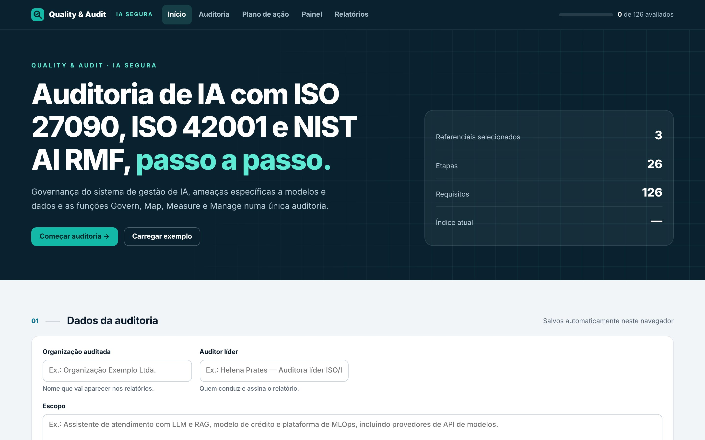
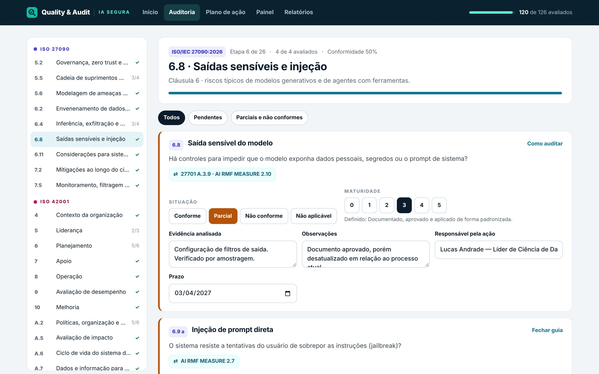
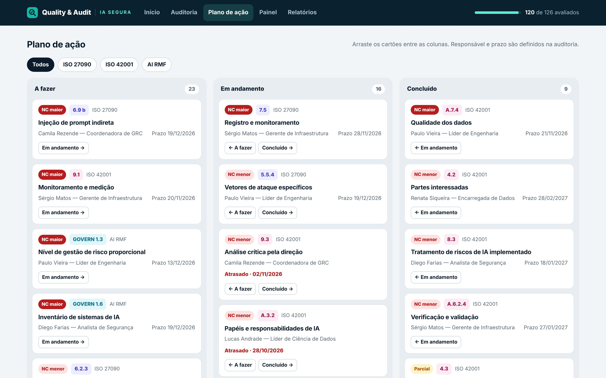
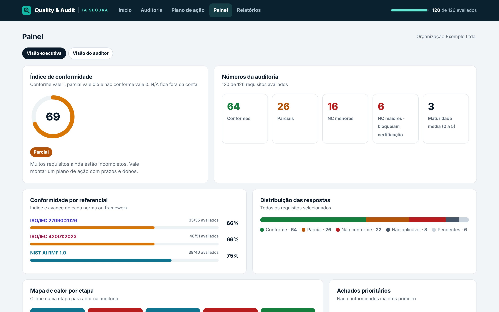
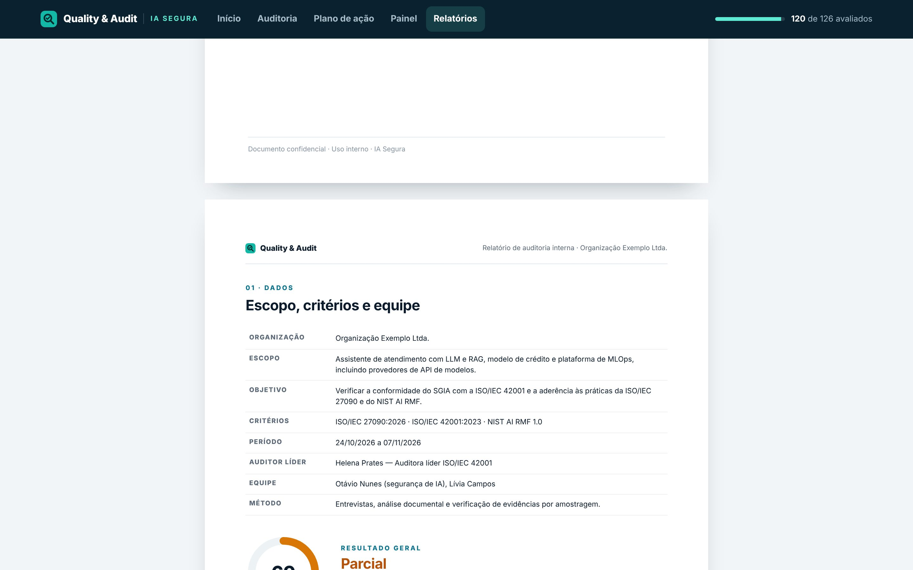

# Quality & Audit

Seis roteiros de auditoria em HTML que rodam direto no navegador. Não precisam de instalação, servidor nem internet. Cada arquivo junta normas e frameworks que costumam ser auditados juntos. Você avalia cada requisito com orientação, trata os achados num plano de ação e gera relatórios A4 em PDF.



## Roteiros

| # | Arquivo | Referenciais | Etapas | Requisitos |
|---|---------|--------------|:------:|:----------:|
| 01 | [IA segura](docs/01_IA_Segura_ISO27090_ISO42001_AIRMF.html) | ISO/IEC 27090:2026 · ISO/IEC 42001:2023 · NIST AI RMF 1.0 | 26 | 126 |
| 02 | [SGSI + CSF](docs/02_SGSI_ISO27001_NIST_CSF2.html) | ISO/IEC 27001:2022 · NIST CSF 2.0 | 18 | 106 |
| 03 | [Privacidade](docs/03_Privacidade_ISO27701_NIST_PF.html) | ISO/IEC 27701:2025 · NIST Privacy Framework 1.0 | 14 | 85 |
| 04 | [Controles técnicos](docs/04_Controles_Tecnicos_NIST80053_CIS81.html) | NIST SP 800-53 Rev. 5 (baseline moderada) · CIS Controls v8.1 | 14 | 82 |
| 05 | [Gestão de riscos](docs/05_Riscos_ISO27005_ISO31000_COSO_ERM.html) | ISO/IEC 27005:2022 · ISO 31000:2018 · COSO ERM 2017 | 12 | 72 |
| 06 | [HPC Security](docs/06_HPC_NIST_SP800-223_SP800-234.html) | NIST SP 800-223 · NIST SP 800-234 | 11 | 62 |

## Como usar

1. Baixe o HTML do roteiro que você quer usar. Os arquivos ficam na pasta `docs/`.
2. Abra no Chrome, no Edge ou no Firefox. Funciona sem internet.
3. Em **Início**, preencha os dados da auditoria e escolha os referenciais.
4. Em **Auditoria**, percorra as etapas. Para cada requisito, marque Conforme, Parcial, Não conforme ou Não aplicável, registre a evidência e a maturidade de 0 a 5. O botão **Como auditar** mostra o que procurar, as evidências esperadas e as correlações com os outros referenciais.
5. Itens parciais e não conformes vão para o **Plano de ação**, um quadro em que você arrasta os cartões entre A fazer, Em andamento e Concluído.
6. Acompanhe o **Painel**, com a visão executiva e a visão do auditor.
7. Em **Relatórios**, escolha o relatório executivo ou o de auditoria e use "Salvar como PDF" na janela de impressão.

Quer ver tudo preenchido antes de começar? Use **Carregar exemplo** na tela inicial.

### Onde ficam os dados

As respostas ficam no armazenamento local do navegador, separadas por roteiro. Nada é enviado para fora do computador. Por isso:

- limpar os dados do navegador apaga a auditoria;
- outro navegador ou computador não vê o que você preencheu;
- para guardar ou mover a auditoria, use **Exportar backup (.json)** e depois **Importar backup**.


## Telas

| Auditoria | Plano de ação |
|---|---|
|  |  |

| Painel | Relatório A4 |
|---|---|
|  |  |

## Sobre o conteúdo

- **Não é o texto oficial das normas.** Os requisitos foram escritos como perguntas de auditoria, com o número da cláusula ou do controle para consulta. Para a redação exata, consulte a publicação original.
- **Publicações do NIST** são de domínio público e foram traduzidas e resumidas livremente.
- **CIS Controls**: os títulos das salvaguardas foram resumidos em português. O texto oficial é distribuído pelo CIS sob licença CC BY-NC-ND 4.0.
- **Correlações (⇄)** entre referenciais são indicativas, feitas para orientar a auditoria integrada. Não são mapeamentos oficiais.
- **Situação das publicações** em novembro de 2026: a ISO/IEC 27090 foi publicada em outubro de 2026, o NIST SP 800-234 em maio de 2026 e o NIST Privacy Framework 1.1 ainda é rascunho, por isso o roteiro 03 usa os identificadores da versão 1.0.
- **Revisão**: os roteiros foram preparados com apoio de IA. Revise perguntas e correlações antes de usar o material numa auditoria formal. Correções são bem-vindas por issue ou pull request.

## Estrutura

```
.
├── README.md
├── docs/
│   ├── index.html                 página inicial com os seis roteiros
│   └── 0X_*.html                  um arquivo autocontido por roteiro
└── imagens/                       capturas usadas neste README
```

Cada HTML é autocontido: interface, estilos, lógica e conteúdo no mesmo arquivo, sem bibliotecas nem fontes externas.

## Autor

Jaime · [@jgamacyber](https://github.com/jgamacyber)
